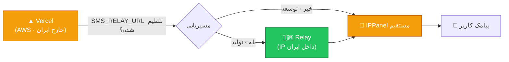
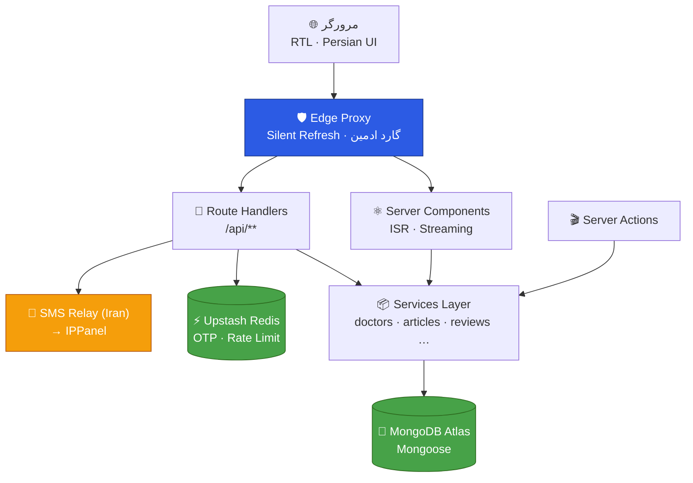
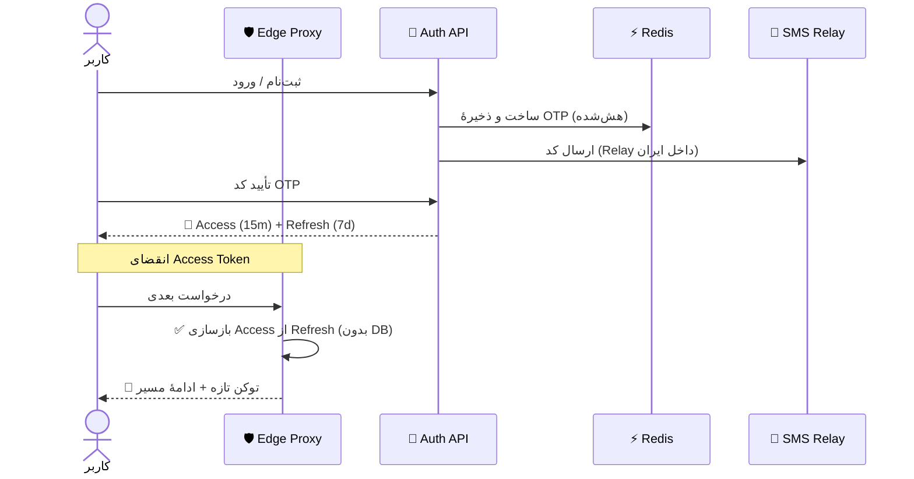
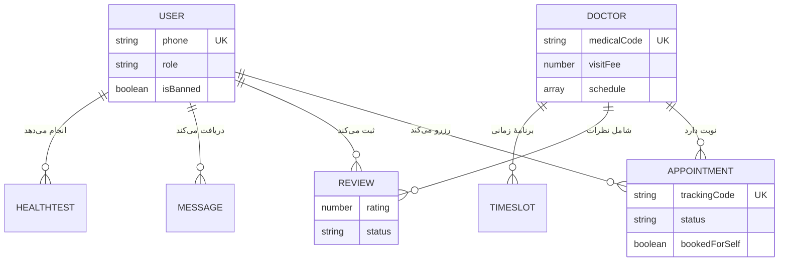

<div align="center">

<br/>


<br/><br/>

<h1>🩺 دکتر رزرو</h1>

<h3>پلتفرم نوبت‌دهی آنلاین پزشک — سریع، امن، و آمادهٔ تولید</h3>

<p align="center">
<em>از جست‌وجوی پزشک متخصص تا رزرو نوبت با کد رهگیری — در کمتر از یک دقیقه ⏱️</em>
</p>

<br/>

<p align="center">
  
  
  
  
  
  
</p>

<p align="center">
  
  
  
  
  
</p>

<br/>

<!-- 📊 آمار زندهٔ پروژه — استخراج‌شده از کد واقعی -->
<table align="center">
<tr>
<td align="center"><b>📦 ~24K</b><br/><sub>خط کد</sub></td>
<td align="center"><b>📄 338</b><br/><sub>فایل منبع</sub></td>
<td align="center"><b>🔌 26</b><br/><sub>API Route</sub></td>
<td align="center"><b>📃 32</b><br/><sub>صفحه</sub></td>
<td align="center"><b>🧩 150+</b><br/><sub>کامپوننت</sub></td>
<td align="center"><b>🗄️ 9</b><br/><sub>مدل داده</sub></td>
<td align="center"><b>🧪 18</b><br/><sub>فایل تست</sub></td>
</tr>
</table>

<br/>

<samp>Next.js 16 · React 19 · TypeScript strict · Tailwind v4 · MongoDB · Upstash Redis</samp>

</div>

---

<div align="center">

## 🚀 شروع سریع و دسترسی دمو

<sub>قبل از هر چیز این باکس را بخوانید — دو نکته که بهترین تجربه را برایتان می‌سازند ✨</sub>

</div>

<br/>

<table align="center" width="100%">
<tr>
<td align="center" width="50%" valign="top">

### 🔐 ورود به پنل مدیریت

<sub>برای تجربهٔ کامل پنل ادمین وارد شوید</sub>

<br/>

|  |  |
|:--|:--|
| 👤 **نام کاربری** | `09018106646` |
| 🔑 **رمز عبور** | `12345678m` |

<br/>

<sub>↩️ پس از ورود به مسیر <code>/admin</code> بروید 🛡️</sub>

</td>
<td align="center" width="50%" valign="top">

### 📱 فعال‌سازی کد پیامکی (OTP)

<sub>ارسال پیامک فقط در اجرای محلی فعال است</sub>

<br/>

```bash
npm install
npm run build
npm run start   # ✅ OTP فعال
```

<br/>

<sub>کد یک‌بارمصرف مستقیماً برای شمارهٔ شما ارسال می‌شود 📨</sub>

</td>
</tr>
</table>

<br/>

> [!CAUTION]
> **چرا ارسال پیامک در حالت آنلاین کار نمی‌کند؟** 📱
>
> سرویس **IPPanel** (پشت Cloudflare) درخواست‌های API را فقط از **IP داخل ایران** می‌پذیرد و درخواست‌های دیتاسنتر خارج از کشور (مثل Vercel روی AWS) را با خطای `502` رد می‌کند. چون هاستِ نسخهٔ آنلاین خارج از ایران است، کد OTP ارسال نمی‌شود. 🌍🚫
>
> ✅ **راه‌حل توسعه:** پروژه را با `npm run start` روی سیستمی با IP ایران اجرا کنید.
> 🏭 **راه‌حل تولید:** معماری **SMS Relay** (بخش [متغیرهای محیطی](#-متغیرهای-محیطی)) این محدودیت را کاملاً برطرف می‌کند.

> [!TIP]
> در حالت آنلاین **همهٔ بخش‌های دیگر** — جست‌وجوی پزشک، پروفایل‌ها، رزرو، مقالات و کل پنل ادمین — کاملاً فعال‌اند؛ تنها مرحلهٔ **تأیید پیامکی ثبت‌نام** به اجرای محلی (یا Relay) نیاز دارد.

---

## 📖 فهرست مطالب

<table>
<tr>
<td valign="top">

- [🎯 دربارهٔ پروژه](#-دربارهٔ-پروژه)
- [✨ ویژگی‌ها](#-ویژگیها)
- [🏆 تصمیم‌های مهندسی](#-تصمیمهای-مهندسی-engineering-highlights)
- [🧰 پشتهٔ فناوری](#-پشتهٔ-فناوری)

</td>
<td valign="top">

- [🏛️ معماری سامانه](#️-معماری-سامانه)
- [🗄️ مدل‌های داده](#️-مدلهای-داده)
- [📂 ساختار پروژه](#-ساختار-پروژه)
- [🔐 امنیت](#-امنیت)

</td>
<td valign="top">

- [🚀 کارایی و SEO](#-کارایی-و-seo)
- [🏁 راه‌اندازی محلی](#-راهاندازی-محلی)
- [🔧 متغیرهای محیطی](#-متغیرهای-محیطی)
- [🧪 تست · 📜 اسکریپت · ☁️ استقرار](#-تست-و-کیفیت)

</td>
</tr>
</table>

---

## 🎯 دربارهٔ پروژه

**دکتر رزرو** یک سامانهٔ کامل و **آمادهٔ تولید (production-ready)** برای نوبت‌دهی آنلاین پزشکی است: از جست‌وجوی پزشک متخصص و مشاهدهٔ زمان‌های خالی تا رزرو نوبت با **کد رهگیری یکتا**، ثبت نظر، و یک **پنل مدیریت** تمام‌عیار برای ادارهٔ پزشکان، کاربران، مقالات و پیام‌ها.

طراحی پروژه حول چهار اصل می‌چرخد: **معماری تمیز**، **کارایی بالا**، **امنیت لایه‌به‌لایه**، و **تجربهٔ کاربری اصیل فارسی (RTL)** — همه بر پایهٔ **Next.js 16 / App Router** و **React 19 Server Components**.

> [!NOTE]
> بیش از **۲۴٬۰۰۰ خط** TypeScript در **۳۳۸ فایل**، با سخت‌گیرانه‌ترین حالت کامپایلر (`strict` + `noUncheckedIndexedAccess` + `exactOptionalPropertyTypes`) و الزام **صفر خطای `tsc --noEmit`** پیش از هر تحویل.

<table>
<tr>
<td align="center" width="33%">🔍<br/><b>جست‌وجوی هوشمند</b><br/><sub>فیلتر تخصص · شهر · بیمه · جنسیت · نوع ویزیت — همه در URL</sub></td>
<td align="center" width="33%">📅<br/><b>رزرو اتمیک</b><br/><sub>قفل نوبت در یک round-trip و بستن کامل شکاف TOCTOU</sub></td>
<td align="center" width="33%">📱<br/><b>احراز هویت OTP</b><br/><sub>پیامک کد یک‌بارمصرف با معماری Relay مخصوص ایران</sub></td>
</tr>
<tr>
<td align="center">⭐<br/><b>نظرات با تأیید</b><br/><sub>بازبینی ادمین پیش از انتشار</sub></td>
<td align="center">📝<br/><b>مجلهٔ سلامت</b><br/><sub>ویرایشگر غنی Tiptap</sub></td>
<td align="center">🛡️<br/><b>پنل ادمین کامل</b><br/><sub>داشبورد · CRUD · مدیریت کاربران</sub></td>
</tr>
</table>

---

## ✨ ویژگی‌ها

<details open>
<summary><b>👤 سمت کاربر (Patient-Facing)</b></summary>

<br/>

| ویژگی | توضیح |
|:------|:------|
| 🏠 **صفحهٔ اصلی پویا** | پزشکان محبوب و جدید، تخصص‌ها، نظرات و مقالات — با ISR و کش لبه |
| 🔎 **جست‌وجوی پیشرفته** | فیلتر تخصص/شهر/بیمه/جنسیت/نوع ویزیت + مرتب‌سازی، همه در URL با `nuqs` |
| 🩺 **پروفایل پزشک** | سوابق، تعرفه، آدرس، تقویم زمان‌های خالی و نظرات تأییدشده |
| 📅 **رزرو چندمرحله‌ای** | انتخاب نوبت → تأیید → پرداخت → موفقیت، با **کد رهگیری** یکتا |
| 👥 **رزرو برای دیگران** | ثبت نوبت برای فرد دیگر با نام و شمارهٔ بیمار |
| 🚫 **قانون یک نوبت در روز** | جلوگیری از دو نوبت فعال هم‌زمان در یک روز |
| 🧑‍💼 **پروفایل کاربری** | ویرایش اطلاعات، آپلود آواتار، کد ملی، تاریخ تولد شمسی |
| 📨 **صندوق پیام** | دریافت پاسخ ادمین و نتایج آزمون‌های سلامت |
| ❤️ **آزمون سلامت قلب** | کوییز تعاملی با ارسال نتیجه به ادمین |
| 📚 **مجلهٔ سلامت** | فهرست و صفحهٔ تک‌مقاله با slug فارسی |

</details>

<details>
<summary><b>🛡️ پنل مدیریت (Admin Dashboard)</b></summary>

<br/>

| بخش | قابلیت‌ها |
|:----|:---------|
| 📊 **داشبورد** | شاخص‌های کلیدی و نمای کلی |
| 🧑‍⚕️ **پزشکان** | افزودن/ویرایش/حذف، آپلود تصویر، تنظیم برنامهٔ زمانی |
| 📝 **مقالات** | ساخت و ویرایش با Tiptap، وضعیت پیش‌نویس/منتشرشده |
| 👥 **کاربران** | مشاهده و **مسدودسازی (ban)** کاربران |
| ⭐ **نظرات** | تأیید یا رد نظرات در صف انتظار |
| 📬 **پیام‌های تماس** | مشاهده، تغییر وضعیت و **ارسال پاسخ** به کاربر |
| 🧪 **آزمون‌های سلامت** | بررسی پاسخ‌ها و پاسخ‌دهی به کاربر |

</details>

<details>
<summary><b>⚙️ زیرساخت و مهندسی</b></summary>

<br/>

- 🔐 احراز هویت **JWT دو‌توکنی** (Access 15m + Refresh 7d) روی کوکی httpOnly
- ♻️ **تمدید خاموش توکن (Silent Refresh)** در لایهٔ Edge Proxy، بدون هیچ خواندنی از دیتابیس
- 📱 **OTP پیامکی** با معماری Relay برای دور زدن مسدودسازی جغرافیایی
- 🚦 **محدودسازی نرخ** با Upstash Redis روی OTP و ورود
- 🌐 **SEO کامل** — `robots.ts`، `sitemap.ts` پویا با ISR، OpenGraph و Canonical
- 🧪 **پوشش تست** سه‌لایه با Playwright (unit / api / e2e)

</details>

---

## 🏆 تصمیم‌های مهندسی (Engineering Highlights)

<div align="center">
<sub>این بخش قلب پروژه است — جایی که تصمیم‌های عمدی مهندسی، تفاوت بین «یک اپ کارراه‌انداز» و «یک سامانهٔ آمادهٔ تولید» را می‌سازند 🧠✨</sub>
</div>

<br/>

### ⚡ ۱) رزرو اتمیک نوبت — بستن شکاف TOCTOU

مشکل کلاسیک رزرو، شرایط رقابتی (race condition) است: دو کاربر هم‌زمان یک نوبت را می‌بینند، هر دو «خالی بودن» را چک می‌کنند و هر دو رزرو می‌کنند. راه‌حل ساده‌لوحانه (اول بخوان، بعد بنویس) دقیقاً همین شکاف **TOCTOU** را باز می‌گذارد.

راه‌حل این پروژه: **زمان نوبت بخشی از فیلترِ کوئری است**، پس MongoDB در یک عملیات اتمیک `findOneAndUpdate` تنها برای **یک** درخواست تطبیق می‌دهد؛ بازندهٔ رقابت `null` می‌گیرد و هیچ‌گاه دو رزرو روی یک اسلات ثبت نمی‌شود.

```ts
// 🔒 Atomically claim the slot in ONE round-trip.
// The time lives inside the query filter → MongoDB matches it for exactly
// one racing request (the loser receives null) → the TOCTOU window closes. ⚡
const claimed = await Doctor.findOneAndUpdate(
  { _id: doctorId, schedule: { $elemMatch: { date, times: time } } },
  { $pull: { "schedule.$.times": time } },
  { new: true },
);
```

> [!IMPORTANT]
> اگر ثبتِ خودِ رکورد `Appointment` شکست بخورد، اسلات نباید بی‌صدا سوخته بماند؛ یک **عملیات جبرانی (compensating action)** زمان را به برنامهٔ پزشک بازمی‌گرداند. الگوی «claim → persist → rollback-on-failure» یک ساگای مینیمالِ درست‌طراحی‌شده است. ♻️

<br/>

### ♻️ ۲) تمدید خاموش توکن روی لبه — بدون یک بایت خواندن از دیتابیس

توکن `Access` فقط ۱۵ دقیقه عمر دارد. به‌جای آنکه کاربر با انقضای آن دوباره لاگین کند، لایهٔ **Edge Proxy** (در Next.js 16 جایگزین middleware و با نامِ الزامیِ `proxy`) به‌صورت خاموش یک Access تازه صادر می‌کند.

نکتهٔ ظریف: **نقش کاربر (`role`) درون Refresh Token حمل می‌شود**، بنابراین لبه می‌تواند بدون هیچ کوئری‌ای به دیتابیس، توکن تازه بسازد و Edge-safe و سبک بماند. اعتبارسنجی قطعیِ نقش و وضعیت `ban` بعداً در لایهٔ Node (لایوت ادمین و Route Handlerها) دوباره از دیتابیس انجام می‌شود.

```ts
// 🔄 Silent refresh at the edge: access expired but refresh still valid
// → mint a fresh access token. Role rides inside the refresh token,
// so ZERO database reads happen here — the edge stays lean & Edge-safe. 🧠
if (!accessToken && refreshToken) {
  const payload = await verifyRefreshToken(refreshToken).catch(() => null);
  if (payload?.userId) {
    const role = typeof payload.role === "string" ? payload.role : "user";
    const newToken = await createAccessToken(String(payload.userId), role);
    // 🩹 forward the fresh cookie on the request too → SSR & /me read it instantly ✨
  }
}
```

> [!NOTE]
> **مدل امنیتی دولایه:** لبه یک گاردِ *خوش‌بینانه* (optimistic) است تا سریع بماند؛ منبع حقیقتِ نقش و ban، لایهٔ Node است. سرعتِ لبه بدون قربانی‌کردن قطعیت.

<br/>

### 📱 ۳) معماری SMS Relay — عبور از مسدودسازی جغرافیایی

سرویس IPPanel (پشت Cloudflare) درخواست از IP دیتاسنتر خارج از ایران را با `502` رد می‌کند — یعنی روی Vercel، ارسال پیامک عملاً غیرممکن است. راه‌حل: یک **Relay داخل ایران**.

مسیریابی هوشمند در همان provider حل شده: اگر `SMS_RELAY_URL` تنظیم شده باشد، درخواست به Relay داخل ایران forward می‌شود (تولید)؛ در غیر این صورت مستقیم IPPanel صدا زده می‌شود (توسعهٔ محلی). مهم‌تر از همه: **کلیدهای IPPanel هرگز روی Vercel قرار نمی‌گیرند** و روی Relay باقی می‌مانند.



<br/>

### 🌐 ۴) Resolver ضدنشتِ localhost — SEO ضدخطای انسانی

یک باگِ رایج در تولید: نشتِ `http://localhost:3000` به تگ‌های canonical/OG و sitemap. اینجا یک **Resolver مرکزی** با ترتیب اولویت، این خطا را ساختاری غیرممکن می‌کند: حتی اگر کسی سهواً `NEXT_PUBLIC_BASE_URL=localhost` را روی Vercel بگذارد، نادیده گرفته می‌شود.

```ts
// ⭐ Explicit override wins — EXCEPT a localhost value while on Vercel.
// A stray NEXT_PUBLIC_BASE_URL=localhost must never leak into production
// canonical/OG tags. Single source of truth for every absolute URL. 🧠
const explicitIsLocal = !explicit || /localhost|127\.0\.0\.1/.test(explicit);
if (explicit && !(onVercel && explicitIsLocal)) return explicit;
```

<br/>

### 🚦 ۵) دفاع لایه‌به‌لایه در برابر سوءاستفاده

| سازوکار | سیاست |
|:--------|:------|
| 🔢 **OTP** | کد ۵ رقمی · انقضای ۵ دقیقه · حداکثر ۳ تلاش · حداکثر ۳ ارسال در پنجرهٔ ۱۰ دقیقه‌ای · فاصلهٔ حداقل ۶۰ ثانیه بین دو ارسال |
| 🛡️ **Brute-Force ورود** | حداکثر ۸ تلاش در ۵ دقیقه به‌ازای هر IP، با استراتژی `fail-open` (خرابیِ Redis نباید کاربران واقعی را قفل کند) |
| ♻️ **Idempotent booking** | قانون «یک نوبت فعال در روز» + بازگشت جبرانی اسلات در خطا |

---

## 🧰 پشتهٔ فناوری

<table>
<tr>
<td valign="top" width="50%">

**🎨 Frontend & UI**
- `Next.js 16` — App Router
- `React 19.2` — Server Components
- `TypeScript 5.9` — strict کامل
- `Tailwind CSS v4`
- `shadcn/ui` (سبک new-york) · `Radix UI`
- `AOS` · `Swiper` · `Lucide` · `Sonner`

</td>
<td valign="top" width="50%">

**⚙️ Backend & Data**
- `MongoDB Atlas` + `Mongoose 9`
- `Upstash Redis` + `@upstash/ratelimit`
- `jose` — JWT (Edge-safe)
- `bcryptjs` — هش رمز
- `Zod 4` + `React Hook Form`
- `SWR` · `nuqs` · `IPPanel`

</td>
</tr>
<tr>
<td valign="top">

**🇮🇷 ابزارهای فارسی**
- `jalaali-js` — تاریخ شمسی
- `react-multi-date-picker`
- فونت `Vazirmatn` (preload · woff2)
- regex متمرکز (موبایل / کد ملی)

</td>
<td valign="top">

**🧪 کیفیت و تست**
- `Playwright` — unit · api · e2e
- `ESLint 9` · `Prettier`
- `Tiptap 3` — ویرایشگر غنی
- TypeScript strict + صفر خطای `noEmit`

</td>
</tr>
</table>

---

## 🏛️ معماری سامانه



### 🔑 جریان احراز هویت



---

## 🗄️ مدل‌های داده



| مدل | نقش | نکات کلیدی |
|:----|:-----|:----------|
| **User** | کاربر/ادمین | `password` با `select:false` · ایمیل sparse-unique · `isBanned` |
| **Doctor** | پزشک | زیراسکیمای `schedule` و `reviews` · ویرچوال `firstAvailable` و `reviewStats` |
| **Appointment** | نوبت | `trackingCode` یکتا · `bookedForSelf` · active/expired/cancelled |
| **Article** | مقاله | `slug` یکتا · draft/published · tags |
| **City** | شهر | کالکشن مرجع پویا برای فیلتر شهرها |
| **ContactMessage** | پیام تماس | new/seen/replied · `adminReply` |
| **Message** | پیام صندوق | پیوند اختیاری به نتیجهٔ آزمون سلامت |
| **HealthTestResult** | نتیجهٔ آزمون | snapshot اطلاعات کاربر در زمان آزمون |
| **NewsletterSubscriber** | مشترک خبرنامه | active/unsubscribed |

---

## 📂 ساختار پروژه

> [!TIP]
> پروژه با اصل **تفکیک مسئولیت‌ها (Separation of Concerns)** سازمان‌دهی شده: مسیرها، کامپوننت‌ها، و منطق دامنه (`lib`) کاملاً از هم جدا هستند.

<details open>
<summary><b>🌳 درخت پروژه</b></summary>

```text
doctor-booking/
│
├── 📂 src/
│   ├── 📱 app/                      ← App Router (مسیرها، لایوت‌ها، API)
│   │   ├── 🏠 (home)/               صفحهٔ اصلی — ISR، بدون کوکی، کاملاً کش‌شده
│   │   ├── 🌐 (main)/               صفحات عمومی
│   │   │   ├── doctors/[id]/        فهرست + پروفایل پزشک + نظر
│   │   │   ├── booking/             confirm · payment · success
│   │   │   ├── articles/[slug]/     مجله + تک‌مقاله
│   │   │   ├── appointments/ · profile/ · inbox/
│   │   │   └── about-us · contact-us · faq · specialties
│   │   ├── 🛡️ admin/                پنل مدیریت (force-dynamic · گارد ادمین)
│   │   │   ├── doctors/ · articles/ · users/ · reviews/
│   │   │   ├── contact-messages/ · health-tests/
│   │   │   └── layout.tsx           ⟵ requireAdmin() از دیتابیس
│   │   ├── 🔑 auth/                 login · register · banned
│   │   ├── 🔌 api/                  ۲۶ Route Handler
│   │   ├── 🤖 robots.ts             متادیتای SEO
│   │   ├── 🗺️ sitemap.ts            sitemap پویا (پزشکان + مقالات) با ISR
│   │   └── 🎨 globals.css           پالت رنگ + تم RTL ویرایشگر Tiptap
│   │
│   ├── 🧩 components/
│   │   ├── ui/          (26)        کامپوننت‌های shadcn/ui (سبک new-york)
│   │   ├── features/    (82)        ⭐ دامنه‌محور: home · doctors · booking · profile · auth …
│   │   ├── admin/       (25)        اجزای پنل مدیریت
│   │   ├── shared/      (25)        doctor-card · reviews · pagination · inbox
│   │   ├── layout/                  header · footer · newsletter
│   │   └── providers/               AOS · Zod-fa · DeferredToaster
│   │
│   ├── 📚 lib/                      ← منطق دامنه و زیرساخت
│   │   ├── 🔐 auth/                 jwt · session · cookies · login-rate-limit · require-api-admin
│   │   ├── 🍃 db/
│   │   │   ├── connection.ts        کش اتصال + تشخیص دقیق خطا
│   │   │   └── models/    (9)       User · Doctor · Appointment · Article · City …
│   │   ├── 📱 otp/                  service · limiter · redis · config · errors
│   │   ├── 📨 sms/                  provider با مسیریابی Relay
│   │   ├── 📦 services/   (12)      لایهٔ داده (doctors · articles · reviews · admin-*)
│   │   ├── 🎬 actions/    (7)       Server Actions
│   │   ├── ✅ validations/(9)       اسکیماهای Zod + regex متمرکز
│   │   ├── 📌 constants/            specialties · filters · site URL resolver
│   │   └── 🛠️ utils/                persian-format · seo · cn · jalaali …
│   │
│   ├── 🪝 hooks/          (9)       useDoctors · useJalaali · useFilterParams …
│   ├── 📐 types/                    تایپ‌های مشترک
│   ├── 🔤 fonts/                    Vazirmatn (woff2)
│   └── 🛡️ proxy.ts                  ⟵ Edge Proxy (Silent Refresh · گارد)
│
├── 🧪 tests/         (18)          unit · api · e2e (Playwright)
├── ⚙️ next.config.ts               هدرهای امنیتی · بهینه‌سازی · تصاویر
├── 🎭 playwright.config.ts         سه پروژهٔ تست
└── 📦 package.json
```

</details>

### 🧭 راهنمای پوشه‌های کلیدی

| پوشه | مسئولیت | چرا اینجا؟ |
|:-----|:--------|:-----------|
| `app/(home)` | صفحهٔ اصلی | جدا از `(main)` چون **هیچ کوکی نمی‌خواند** → کاملاً کش‌شده با ISR |
| `app/admin` | پنل مدیریت | `force-dynamic` + گارد `requireAdmin()` در لایوت |
| `lib/services` | لایهٔ داده | تنها مرز تماس با دیتابیس — قابل استفادهٔ مجدد در RSC و API |
| `lib/auth` | احراز هویت | منطق JWT و Proxy، Edge-safe و بدون وابستگی به Mongoose |
| `lib/validations` | اعتبارسنجی | اسکیماهای Zod + regex متمرکز (single source of truth) |
| `components/features` | UI دامنه‌محور | هر دامنه کامپوننت‌های خودش را دارد |

---

## 🔐 امنیت

| لایه | محافظت |
|:-----|:-------|
| 🍪 **توکن‌ها** | کوکی httpOnly — مصون در برابر دسترسی جاوااسکریپت کلاینت |
| 🔑 **رمز عبور** | هش با bcrypt + حذف فیلد از خروجی کوئری (`select:false`) |
| 🛡️ **هدرها** | `X-Content-Type-Options: nosniff` · `X-Frame-Options: SAMEORIGIN` · `Referrer-Policy` · حذف `X-Powered-By` |
| 🚦 **Brute-Force** | ۸ تلاش ورود در ۵ دقیقه به‌ازای هر IP (استراتژی fail-open) |
| 🔢 **OTP** | کد ۵ رقمی · انقضای ۵ دقیقه · حداکثر ۳ تلاش · حداکثر ۳ ارسال در ۱۰ دقیقه |
| 👮 **RBAC** | گارد خوش‌بینانه در Edge + اعتبارسنجی قطعی نقش از DB در Node |
| ✅ **اعتبارسنجی** | Zod در تمام مرزها (API/اکشن/فرم) با regex متمرکز |

---

## 🚀 کارایی و SEO

<table>
<tr>
<td width="50%" valign="top">

### ⚡ کارایی
- رندر Server Components + **ISR** روی صفحات پرترافیک
- **Tree-shaking** ایمپورت‌های barrel با `optimizePackageImports`
- تصاویر **AVIF/WebP** با کش لبهٔ یک‌روزه
- **Preload فونت** Vazirmatn با `display: swap`
- کش اتصال Mongoose برای Serverless گرم
- هدرهای کش `immutable` برای دارایی‌های برند

</td>
<td width="50%" valign="top">

### 🔍 SEO
- `metadataBase` با **Resolver ضدنشت localhost**
- `sitemap.ts` **پویا** (پزشکان + مقالات) با ISR ساعتی
- `robots.ts` با مسدودسازی مسیرهای خصوصی
- متادیتای **OpenGraph / Twitter Card** و Canonical
- slugهای فارسی به‌درستی percent-encode شده

</td>
</tr>
</table>

<br/>

<div align="center">

### 🏆 نتایج Google Lighthouse

<sub>ممیزی‌شده با Chrome Lighthouse — اثبات کیفیت در عمل، نه فقط روی کاغذ ✨</sub>

<br/><br/>

<a href="https://s34.picofile.com/file/8490704868/ChatGPT_Image_Jun_23_2026_10_39_18_AM.png">
  
</a>

<br/><br/>

<table>
<tr>
<td align="center" width="25%">⚡<br/><b>Performance</b></td>
<td align="center" width="25%">♿<br/><b>Accessibility</b></td>
<td align="center" width="25%">✅<br/><b>Best Practices</b></td>
<td align="center" width="25%">🔍<br/><b>SEO</b></td>
</tr>
</table>

</div>

> [!NOTE]
> این امتیازها حاصل تصمیم‌های مهندسی عمدی‌اند: رندر سمت سرور با ISR، tree-shaking، تصاویر AVIF/WebP، preload فونت، و هدرهای کش بهینه.

---

## 🏁 راه‌اندازی محلی

> [!NOTE]
> **پیش‌نیازها:** Node.js نسخهٔ ۲۰+ · یک پایگاه دادهٔ MongoDB · یک نمونهٔ Upstash Redis

```bash
# ۱) کلون و نصب وابستگی‌ها
git clone <repo-url> doctor-booking
cd doctor-booking
npm install

# ۲) ساخت فایل محیطی
cp .env.example .env.local
#  ↳ سپس مقادیر واقعی را در .env.local قرار دهید

# ۳) اجرای سرور توسعه
npm run dev
```

سپس مرورگر را روی [`http://localhost:3000`](http://localhost:3000) باز کنید. 🚀

> [!WARNING]
> متغیرهای محیطی hot-reload نمی‌شوند؛ پس از هر تغییر در `.env.local`، سرور را **restart** کنید.

---

## 🔧 متغیرهای محیطی

```dotenv
# 🍃 MongoDB Atlas — رشتهٔ اتصال SRV (رمز عبور را URL-encode کنید)
MONGODB_URI="mongodb+srv://..."

# 🔐 رازهای JWT (هرکدام رشته‌ای تصادفی و طولانی)
ACCESS_TOKEN_SECRET="..."
REFRESH_TOKEN_SECRET="..."

# 📱 پیامک OTP (IPPanel)
SMS_API_KEY="..."
SMS_FROM_NUMBER="..."
SMS_PATTERN_CODE="..."

# 🇮🇷 (اختیاری · تولید) Relay برای عبور از مسدودسازی جغرافیایی IPPanel
SMS_RELAY_URL="https://your-iran-relay.example/send"
SMS_RELAY_SECRET="..."

# ⚡ Upstash Redis (OTP + rate limiting)
UPSTASH_REDIS_REST_URL="..."
UPSTASH_REDIS_REST_TOKEN="..."

# 🌐 دامنهٔ کانونیکال (برای metadataBase / OG / sitemap)
NEXT_PUBLIC_BASE_URL="http://localhost:3000"   # تولید: https://your-domain.ir
```

> [!IMPORTANT]
> **معماری Relay پیامک:** با تنظیم `SMS_RELAY_URL`، ارسال پیامک از طریق یک Relay با IP داخل ایران انجام می‌شود و کلیدهای IPPanel هرگز روی Vercel قرار نمی‌گیرند. اگر تنظیم نشود، در توسعه مستقیماً IPPanel فراخوانی می‌شود.

---

## 🧪 تست و کیفیت

استراتژی تست **سه‌لایه** با Playwright:

```text
🧩 unit  →  منطق خالص: regex · crypto OTP · تاریخ شمسی · فرمت فارسی · Zod
🔌 api   →  Route Handlerها: doctors · contact · newsletter
🎭 e2e   →  جریان کاربر: home · doctors · navigation · auth-guards · RTL/A11y
```

**استانداردهای کیفیت کد:**
- ✅ TypeScript در سخت‌گیرانه‌ترین حالت با الزام **صفر خطای `tsc --noEmit`**
- 🎨 یکدستی با Prettier و ESLint 9
- 🧠 کامنت‌های انگلیسی **مختصر، خوانا و باکیفیت** در سراسر کد

### 📜 اسکریپت‌ها

| دستور | کاربرد |
|:------|:-------|
| `npm run dev` | اجرای سرور توسعه |
| `npm run build` | ساخت نسخهٔ تولید |
| `npm run start` | اجرای نسخهٔ تولید (✅ OTP فعال) |
| `npm run lint` | بررسی با ESLint |
| `npm run test` | اجرای تمام تست‌های Playwright |
| `npm run test:unit` | فقط تست‌های واحد (بدون مرورگر) |
| `npm run test:api` | فقط تست‌های API |
| `npm run test:e2e` | فقط تست‌های End-to-End |
| `npm run test:ui` | اجرای تست‌ها در حالت UI تعاملی |
| `npm run test:report` | نمایش گزارش آخرین اجرای تست |

### ☁️ استقرار (Deployment)

بهینه‌شده برای **Vercel**. چک‌لیست تولید:

- [x] تعریف تمام متغیرهای محیطی در **Settings → Environment Variables** (Production)
- [x] تنظیم `NEXT_PUBLIC_BASE_URL` روی **دامنهٔ واقعی** برای canonical/OG/sitemap درست
- [x] تنظیم **Network Access** در MongoDB Atlas روی `0.0.0.0/0` تا IPهای پویای Vercel مسدود نشوند
- [x] تنظیم `SMS_RELAY_URL` و `SMS_RELAY_SECRET` برای عبور از مسدودسازی جغرافیایی پیامک

---

## 🤝 مشارکت و 📄 مجوز

این یک پروژهٔ **خصوصی** است و تمام حقوق آن محفوظ است. برای پیشنهاد بهبود یا گزارش باگ، لطفاً یک Issue باز کنید.

---

<div align="center">

<br/>

**ساخته‌شده با ❤️ و دقت مهندسی**

<sub>Next.js 16 · React 19 · TypeScript strict · Tailwind v4 · MongoDB · Upstash Redis</sub>

<br/><br/>

<a href="#-دکتر-رزرو">
  
</a>

</div>
